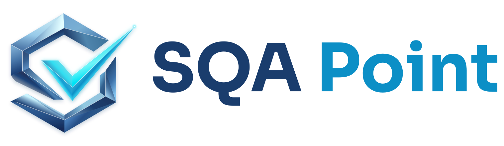

<picture>
  <source media="(prefers-color-scheme: dark)" srcset="assets/logo-dark-bg.svg">
  
</picture>

### ✅ Verify &nbsp;·&nbsp; 💎 Quality &nbsp;·&nbsp; 🚀 Release

Software testing and quality assurance consultancy purpose-built to help organizations deliver **flawless digital experiences at speed**. 
Backed by a seasoned team bringing a collective **50 years of deep, cross-industry QA expertise**, we seamlessly bridge the gap between development velocity and absolute software reliability.

 

---

## 🎯 Our Purpose

> **Help companies release better software faster through AI-assisted testing and automation.**

Whether you are an **agile startup** launching an MVP, a **scaling SaaS company** buried under a manual testing backlog, or an **enterprise** optimizing automated pipelines, SQA Point acts as your **plug-and-play, on-demand QA engine**. ⚙️

---

## 🧩 The Challenge: Overcoming QA Capacity Gaps

Fast-paced development cycles frequently outpace internal testing bandwidth, and hiring full-time senior QA engineers locally is both time-consuming and costly.

<table>
  <tr>
    <td width="33%" valign="top">
      <h3>⚡ Instant Scale</h3>
      Instantly augment your team with battle-tested QA professionals, completely bypassing recruitment bottlenecks.
    </td>
    <td width="33%" valign="top">
      <h3>💰 Cost-Efficient Quality</h3>
      Eliminate the overhead of full-time headcount while instantly securing enterprise-grade testing rigor.
    </td>
    <td width="33%" valign="top">
      <h3>🚀 Release with Confidence</h3>
      Eradicate critical production bugs, clear technical debt, and ensure every release ships on schedule.
    </td>
  </tr>
</table>

---

## ✨ Services We Start With

| | Service |
|:-:|---|
| 🤖 | **AI-generated test cases** from requirements and user stories |
| 🔌 | **API test automation** using tools such as Playwright, pytest, and Postman |
| 🔁 | **Automated regression testing** for existing web applications |
| 🔄 | **CI/CD test integration** and reporting |
| 🔍 | **AI-assisted defect analysis** and test coverage reviews |

---

## 🛠️ Core Service Offerings

| | Offering | What you get |
|:-:|---|---|
| 🧪 | **Automated Testing (Web & Mobile)** | Build robust, highly maintainable automated test suites using modern frameworks (Playwright, Cypress, Selenium) across Python, JavaScript, and Java. |
| 🔄 | **Continuous QA & CI/CD Integration** | Embed automated testing directly into your deployment pipelines (Jenkins, GitLab CI, AWS) for continuous delivery with zero regression surprises. |
| 📈 | **Performance & Load Testing** | Stress-test your architecture to guarantee high availability, rapid response times, and resilience under peak traffic conditions. |
| 🔗 | **API & Integration Testing** | Rigorously validate backend logic, data integrity, and third-party services before deployment. |
| 🧭 | **QA Strategy & Consulting** | Audit your SDLC, implement modern testing best practices, and deploy a custom automation roadmap aligned with your business milestones. |

---

## 🧰 Tools & Technologies

<picture></picture>
<picture></picture>
<picture></picture>
<picture></picture>
<picture></picture>
 
<picture></picture>
<picture></picture>
<picture></picture>
<picture></picture>
<picture></picture>
<picture></picture>

---

## 🏆 Why SQA Point?

- 🎓 **50+ Years of Collective Mastery:** Decades of specialized, hands-on experience spanning 💳 FinTech, ☁️ SaaS, 🏥 Healthcare, and 🛒 E-commerce.
- 🤝 **Flexible Engagement Models:** Seamlessly adapt to your workflow. Choose between dedicated QA capacity embedded directly in your sprints or outcome-based project automation.
- ⚖️ **Velocity Meets Rigor:** Guided by our core pillars, **Verify, Quality, Release**, we ensure that accelerated deployment cycles never compromise software integrity.

---

## 🤝 Let’s Partner for Quality

**Don't let limited QA capacity bottleneck your growth.**

✅ Verify · 💎 Quality · 🚀 Release

